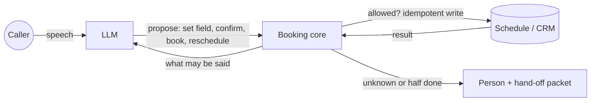

# voice-agent-acceptance-tests

[](https://github.com/galpetame/voice-agent-acceptance-tests/actions/workflows/tests.yml)

**Most voice-agent tests check what the agent said. These check what it did.**

This repo tests the part of a phone-booking voice agent that touches real data: the schedule. It contains:

- 18 go-live checks;
- 8 safety invariants, checked after every step;
- 300 fuzzed multi-caller sessions with injected backend faults;
- a mutation check that plants 12 known bugs and confirms each one is caught;
- a 320-line reference core that passes all of it.

It needs only the Python standard library and pytest. It runs in a few seconds, with no telephony, audio, API keys or model.

```bash
pip install pytest
python -m pytest -q             # 325 tests
python tools/mutation_check.py  # 12/12 planted bugs caught, about a minute
```

## Why this exists

A voice agent that sounds perfect can still:

- book the same technician twice;
- tell a caller "done" when the write timed out;
- move an appointment and leave the old one in place.

Transcript evals don't catch these. They show up in the calendar a week later.

They are caused by ordinary events:

- speech recognition fires on the partial and the final transcript of the same phrase;
- a webhook is retried;
- a slow tool answers after the caller has changed their mind;
- a write times out and nobody knows whether it happened;
- two callers race for the same slot;
- the backend restarts mid-call.

## Where it fits

| Tool | What it tests | What it needs |
|---|---|---|
| [LangWatch Scenario](https://github.com/langwatch/scenario) (open source) | Multi-turn conversations with a simulated user and a judge model, plus assertions on tool calls | Model API keys; minutes per suite |
| [livekit-agent-simulator](https://github.com/quangdang46/livekit_agent_simulator) (open source) | Real WebRTC/SIP calls with an AI caller: barge-in, noise, transport, forensic logs | LiveKit credentials, TTS |
| DeepEval (open source) | Pytest-style metric evals for LLM apps | Model keys for judged metrics |
| Hosted platforms (e.g. Hamming) | Simulated calls at scale, production monitoring | Paid account |
| **This repo** | What the agent did to the schedule under duplicates, stale consent, unknown outcomes, races, half-done reschedules, tenant leaks and restarts | Python and pytest; seconds; no keys |

These tools complement each other. Run this suite on every commit, and run conversation simulations before a release. At the end of any simulated call, `assert_invariants` checks what the agent actually did (see [Use it on your own agent](#use-it-on-your-own-agent)).

## The rule

The model never writes to the schedule. It proposes an action, and the core decides whether that action is allowed. The core makes every write idempotent and lets the agent announce only a result it has verified. Anything uncertain goes to a person with a packet that explains it.



The rules the core enforces:

- **Consent binds to a slot and a version of the request.** Any correction voids it, together with the old offer.
- **One idempotency key per intent:** call, action, request version and slot. A retry with the same key returns the same visit. The same key used for a different request is rejected as a bug.
- **Unknown outcome:** look the write up by its key. Never retry blindly and never confirm falsely. No new writes start until the outcome is settled.
- **Rescheduling is two writes.** It is done only when the new visit exists and the old one is cancelled. Anything else goes to a person with both IDs.
- **Organisation, caller and call are bound to the session.** Words in speech or documents cannot change them.
- **The event log is the source of truth.** A session can be rebuilt from it after a restart.

## The 18 checks

Each check has a deterministic test at the state layer. The last column says what still needs a voice loop or a model eval.

| # | Check | Pass condition | State layer | Still needs |
|---|---|---|---|---|
| 1 | Normal booking | Caller confirms one offered slot explicitly; exactly one visit is created and the verified result is reported | automated | |
| 2 | Partial recognition | Repeated partial and final events for one phrase do not trigger a second booking | automated | |
| 3 | Unclear answer | The agent asks about one field; it never fills in invented data | automated | model eval: is the question clear |
| 4 | Correction | "Not Tuesday, Thursday" replaces the old value in every later request and voids the old offer | automated | model eval: is the correction recognised |
| 5 | Stale confirmation | Agreement to an earlier offer does not authorise booking after address, service or time changed | automated | |
| 6 | Concurrent calls | History, clients and results from one call never appear in another | automated | load test on the real runtime |
| 7 | Organisation isolation | Search and tools never return another organisation's data, even for the same phone number | automated | |
| 8 | Barge-in | The unplayed end of a reply is not counted as said; the next reply accounts for the interruption | automated | voice loop: detecting it and cutting audio |
| 9 | Late read result | After the goal changed, old slots never become the current offer | automated | |
| 10 | Interrupted after write | A write that happened is kept and the result is said again; the interruption is not treated as a cancel | automated | voice loop |
| 11 | Duplicate events | A callback retry does not create a second visit; a reused key with a different request is rejected | automated | |
| 12 | Timeout, unknown outcome | No blind retry; the caller never gets a false confirmation; no new writes until it is settled | automated (both branches) | |
| 13 | Slot race | If another caller took the slot, the agent gets a refusal, drops it from the offer and asks again | automated | |
| 14 | Context overflow | Compressing early history keeps the last correction, refusal and completed-operation status | automated | model eval if a model writes the summary |
| 15 | Instructions in speech or documents | They never change organisation, caller, allowed tools or confirmation rules | automated | red-team model eval for prompt injection |
| 16 | Backend restart | A completed operation is not lost; a stuck one is recovered or handed to a person | automated | |
| 17 | Dates and times | Relative dates resolve in the caller's timezone and are spoken as a concrete date; ambiguous ones are asked | automated | |
| 18 | Hand-off to a person | The operator gets the reason, the parameters and the exact status of every action; the chain is rebuilt from the log | automated | |

The same catalog is kept in [`checks.json`](checks.json). [`tests/test_catalog.py`](tests/test_catalog.py) fails if a check loses its test or drops out of this table.

## Invariants

Examples show that one path works. Invariants must hold after every step of every call, whatever the caller says and whatever the backend does. They are defined in [`invariants.py`](invariants.py).

| ID | Invariant |
|---|---|
| INV-1 | No double booking: in one organisation, a slot holds at most one booked visit |
| INV-2 | Verified success only: a session that says booked points to a booked visit of this caller, in this organisation, at the confirmed slot |
| INV-3 | One write per intent: every visit was created under exactly one idempotency key |
| INV-4 | No false confirmation: while an outcome is unknown or half done, there is nothing positive to announce |
| INV-5 | Tenant isolation: tool results never contain another organisation's or another caller's visits |
| INV-6 | Recoverable: rebuilding the session from its event log gives the same state |
| INV-7 | Reschedule is all or a person: a session never rests at booked while the visit it replaces is unsettled |
| INV-8 | No write without current consent: a visit is created only for the slot and request version the caller confirmed |

### Fuzzing

[`tests/test_invariants.py`](tests/test_invariants.py) runs 300 seeded sessions of 60 steps each. Three callers share one schedule: two in one organisation and one in another, with the same phone number.

The steps mix the normal flow (offer, confirm, book, move) with abuse and faults:

- corrections and empty answers;
- stale tool results;
- timeouts before and after a write;
- failed cancels and late backend writes;
- barge-in;
- restarts rebuilt from the log;
- injected instructions.

The invariants are checked after every step, and any crash counts as a failure. A failure prints the seed and the step trace. Replay one seed, or run more, with:

```bash
VAAT_SEED=42 python -m pytest -q tests/test_invariants.py
VAAT_FUZZ_RUNS=5000 python -m pytest -q tests/test_invariants.py
```

### Bugs this suite found in its own reference core

| Bug | How it was found |
|---|---|
| A second confirmed slot reused the idempotency key and crashed with `IdempotencyConflict`. The key named the request version but not the slot | Fuzzer, on its first realistic run |
| A reschedule whose new booking timed out, then was recovered, said "booked" but never cancelled the old visit | Writing INV-7 |
| `reschedule` could cancel a visit that belonged to another organisation if the model echoed its ID | Writing check 15 |
| Confirmation was not bound to a slot, so a second `book()` returned the first visit for a different slot | Reviewing check 1 |

### Mutation check

[`tools/mutation_check.py`](tools/mutation_check.py) plants 12 known bugs one at a time and runs both suites against each:

- writing without current consent;
- a false confirmation on timeout;
- no idempotency;
- no slot-race check;
- "rescheduled" after a failed cancel;
- a tool that leaks other callers;
- a tool that accepts `org_id` from the conversation;
- a correction that keeps old consent;
- recovery that forgets the second write;
- restore that ignores reschedule state;
- late slots accepted;
- barge-in counted as heard.

Result: **12/12 caught.** The example tests and the invariants cover different bugs. Four of the 12 are caught by only one of the two suites, so neither is enough alone.

## Rescheduling is two writes, not one

"Done, I've moved your appointment" is the most dangerous sentence in this agent. A reschedule creates the new visit, then cancels the old one. If the second write fails, the caller has two visits (or none) while the bot sounds confident.

Success is announced only when both records agree. Otherwise the call goes to a person with both visit IDs. If the new write's outcome is unknown, `recover()` finishes the cancel once the write is found.

## Use it on your own agent

1. **Take the rules, not the code.** The core is a specification you can read in ten minutes. Port its rules to your stack: consent binding, keys per intent, reconcile instead of retry, two-write reschedule, tenant fields bound to the session, and the event log.
2. **Check invariants after conversation simulations.** Sketch:

   ```python
   from invariants import assert_invariants

   def test_caller_changes_date_twice_then_hangs_up(agent):
       run_simulated_call(agent, persona="changes the date twice, hangs up during confirmation")  # your harness
       assert_invariants(agent.schedule, agent.sessions)  # what it did, not just what it said
   ```

3. **Gate go-live in stages.** Each stage gets an artifact, a check and an exit condition. Tool errors and interruptions are tested before any real caller is connected.
   1. Speech recognition on recorded reference audio
   2. Text-only state machine and memory with stubbed tools
   3. Voice loop (audio → text → reply → audio)
   4. Interruptions / barge-in
   5. Sandbox tools
   6. One CRM and one schedule
   7. Telephony
   8. Limited pilot

Claim savings only after measuring these: latency, the share of calls completed end to end, human interventions and cost per completed call.

## Files

| Path | What it is |
|---|---|
| [`booking_core.py`](booking_core.py) | Reference core: schedule stub with fault injection, call session, tools, speech record, compaction, restore |
| [`invariants.py`](invariants.py) | The eight invariants and `assert_invariants` |
| [`checks.json`](checks.json) | The 18 checks as data |
| [`tests/`](tests) | Acceptance tests, invariant fuzzing, catalog consistency |
| [`tools/mutation_check.py`](tools/mutation_check.py) | Plants known bugs and confirms the suites catch them |

## Background

The checks were written before connecting an inbound voice-AI intake agent to real callers. In that flow, a caller books or reschedules a technician visit, a CRM holds the client, and a separate schedule holds availability.

Author: [Tamerlane Galperin](https://www.linkedin.com/in/tamerlane-galperin-30705939b/). I build AI agents and automations that know when to hand off to a person.

MIT License.
